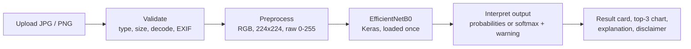

<div align="center">
# 🦷 Oral Disease Classification AI
 
**Upload a photo of an oral condition, get a model prediction, an honest score and a plain-language explanation.**
 


 
</div>
> ⚠️ **Experimental decision-support tool, not a medical diagnosis.** The model has not been clinically validated or
> approved by any regulator. It cannot diagnose or rule out disease. Always consult a qualified dental professional.
 
---
 
## Overview
 
A modular Streamlit application built on top of
[`mhmdsalah10/oral-disease-classifier`](https://github.com/mhmdsalah10/oral-disease-classifier). It classifies a
photograph into one of six categories:
 
`Calculus` · `Caries` · `Gingivitis` · `Hypodontia` · `Mouth Ulcer` · `Tooth Discoloration`
 
The base **EfficientNetB0** model, its metadata and its evaluation figures come from the original repository. This
project adds the application layer: validation, preprocessing, safe inference, honest result presentation, evaluation
dashboards and automated tests.
 
## Features
 
- **Safe uploads:** JPG/JPEG/PNG only, size and dimension limits, corruption and truncation checks, EXIF rotation fix
- **Faithful preprocessing:** RGB, 224×224, raw 0–255 `float32` (no extra rescaling, as the model expects)
- **Honest scores:** detects whether the output is a real probability distribution, labels it accordingly and warns that
  scores are uncalibrated
- **Results dashboard:** top-3 predictions, bar chart, plain-language description, suggested next step, disclaimer
- **Model Insights page:** test metrics, model comparison, per-class F1, confusion matrices (counts or %), derived
  classification report, class distribution, original sample predictions
- **Graceful degradation:** missing weights or optional files never crash the app, and **no fake predictions are ever shown**
- **Privacy by design:** images stay in memory, are never saved or logged, and are never sent to third parties
- **Tested:** 58 passing tests, including a real Keras save/load round trip and headless end-to-end runs of the app
## How it works
 

 
## Quick start (Windows PowerShell)
 
Requires Python 3.10–3.12.
 
```powershell
git clone https://github.com/<your-username>/oral-disease-classifier.git
cd oral-disease-classifier
 
python -m venv .venv
.\.venv\Scripts\Activate.ps1
python -m pip install --upgrade pip
python -m pip install -r requirements.txt
 
# Add the trained weights (they are not stored in Git)
python scripts/download_model.py          # asks before contacting Google Drive
# or copy best_model.keras into .\models\
 
python -m streamlit run app.py
```
 
If activation is blocked: `Set-ExecutionPolicy -Scope Process -ExecutionPolicy Bypass`.
macOS/Linux: activate with `source .venv/bin/activate`.
 
Without the weights the app still starts: **Image Analysis** shows setup help and **Model Insights** works fully.
 
## Model weights
 
The trained `best_model.keras` is **not** in the original repository. Place it in `models/`, or set
`$env:ORAL_MODEL_PATH = "D:\path\to\best_model.keras"`. `model_metadata.json` must come from the same training run.
 
## Configuration
 
| Variable | Default | Purpose |
|---|---|---|
| `ORAL_MODEL_PATH` | `models/best_model.keras` | Model file location |
| `ORAL_METADATA_PATH` | `model_metadata.json` | Metadata file |
| `ORAL_MAX_UPLOAD_MB` | `10` | Upload size limit |
| `ORAL_OUTPUT_ACTIVATION` | `auto` | `auto`, `probabilities` or `softmax` |
| `ORAL_LOW_CONFIDENCE_THRESHOLD` | off | Off by default: no calibration data justifies a value |
| `ORAL_TOP_K` | `3` | Predictions shown |
| `ORAL_AUTO_DOWNLOAD` | `0` | `1` = fetch weights from Google Drive at startup (opt-in) |
 
## Reported performance (from the original repository)
 
| Model | Accuracy | Macro F1 | Lowest class F1 |
|---|---|---|---|
| EfficientNetB0 (used here) | 98.44 % | 97.45 % | 91.73 % (Calculus) |
| Custom CNN | 53.53 % | 47.11 % | 28.46 % |
 
Test set: 1,599 images. These figures come from `model_metadata.json`; the confusion matrices in
`reports/evaluation/` were transcribed from the original figures and are cross-checked against those metrics by the test suite.
 
<p align="center">
  
</p>
## Project structure
 
```
app.py                       Streamlit entry point
config.py                    Settings (environment variables)
model_metadata.json          Classes, input size, preprocessing note, test metrics
src/
  validation.py              Upload checks, quality hints
  preprocessing.py           Tensor creation
  model_loader.py            Model + metadata loading, shape checks, optional download
  inference.py               Output interpretation, top-k, warnings
  evaluation.py              Metrics from real artifacts
  visualizations.py          Plotly / seaborn charts
  medical_information.py     Plain-language class descriptions
  pages.py                   Streamlit pages
scripts/download_model.py    Optional weight download
reports/                     Original figures + evaluation CSVs (with provenance)
tests/                       pytest suite
```
 
## Tests
 
```powershell
python -m pip install -r requirements-dev.txt
python -m pytest -q
```
 
Result when last run (Linux, Python 3.12.3): **58 passed, 1 skipped**. The skipped test loads the real weights and runs
automatically once `best_model.keras` is present.
 
## Known limitations
 
- **Not clinically validated.** It must not be used for diagnosis or treatment decisions.
- **Real weights not yet tested here.** The pipeline was verified with a small stand-in network, not the trained model.
- **Closed set:** there is no "healthy" or "not an oral photo" class, so every image receives one of six labels.
- **Uncalibrated scores:** a high score does not guarantee a correct answer.
- **Unknown data provenance:** the dataset's source, patient diversity and split method are undocumented. Accuracy on a
  held-out split of the same data is likely higher than real-world accuracy.
- Class descriptions are general educational text and have not been reviewed by a clinician.
## Privacy
 
Uploaded images are processed in memory only. They are not written to disk, logged or sent to any third-party service.
Do not use real patient photos on a public deployment.
 
## Credits and license
 
- Base model, metadata and evaluation figures: [`mhmdsalah10/oral-disease-classifier`](https://github.com/mhmdsalah10/oral-disease-classifier)
- Application layer, validation, testing and documentation: this repository
- The original repository contained no license file. Check with its author before redistributing, then add a `LICENSE`
  of your choice here.
 
